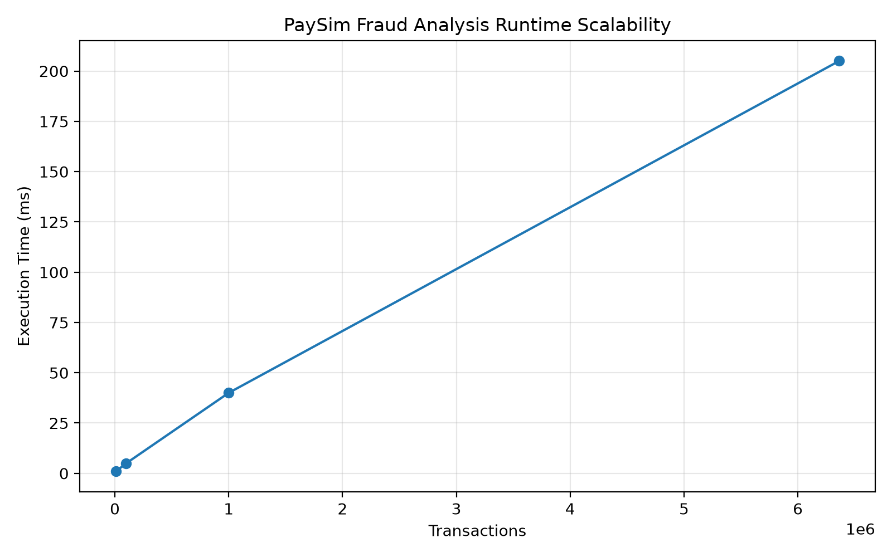
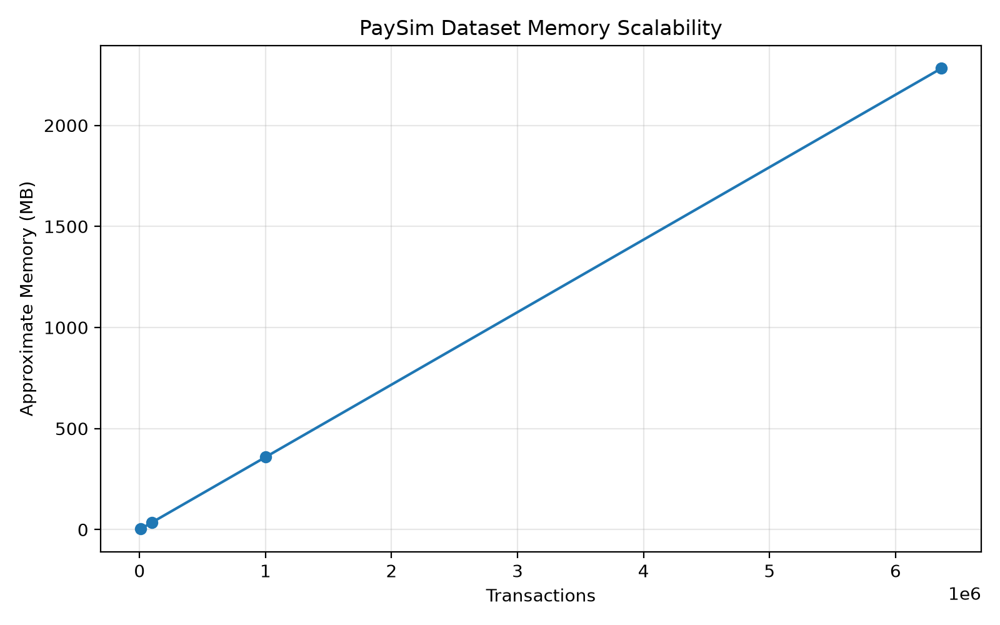
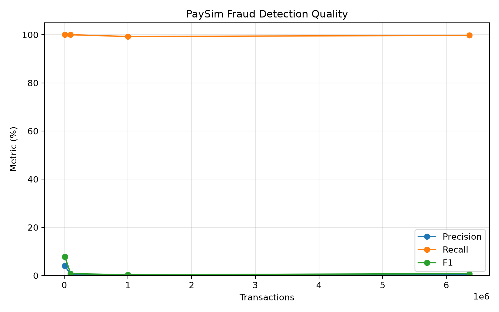

# Banking Transaction Fraud Investigation Workbench

A modular C-based Banking Transaction Fraud Investigation Workbench developed for the **Design and Analysis of Algorithms (DAA)** project.

The system applies classical algorithmic paradigms to realistic fraud-investigation tasks including transaction triage, suspicious-pattern detection, evidence-network analysis, investigation planning, resource allocation, graph optimization, benchmarking, and large-scale fraud evaluation.

---

## 1. Project Overview

Financial fraud investigation requires more than identifying suspicious transactions. Investigators must search large transaction collections, detect suspicious patterns, prioritize cases under limited resources, analyze relationships between accounts, and evaluate alternative investigation strategies.

This project integrates these tasks into a single menu-driven workbench while demonstrating algorithms from major DAA paradigms.

The implementation includes:

- Sorting and searching
- Divide and Conquer
- Greedy algorithms
- Dynamic Programming
- Backtracking
- Branch and Bound
- Graph algorithms
- Network Flow
- Bipartite Matching
- String Matching
- Number Theory
- Automated testing
- Algorithm benchmarking
- Large-scale PaySim fraud evaluation

---

## 2. Project Objectives

The main objectives are to:

1. Apply Design and Analysis of Algorithms concepts to a realistic banking-fraud domain.
2. Compare multiple algorithms solving related problems.
3. Analyze theoretical time and space complexity.
4. Validate algorithms using deterministic correctness tests.
5. Benchmark practical execution behavior.
6. Demonstrate scalability on small, medium, large, adversarial, and public fraud datasets.
7. Separate reusable algorithm implementations from CLI and domain logic.
8. Analyze tractable and computationally difficult problems using P, NP, NP-Complete, and NP-Hard concepts.

---

## 3. System Architecture

```text
                         User
                          |
                          v
                +-------------------+
                |   CLI / Main Menu |
                +---------+---------+
                          |
                          v
                +-------------------+
                | Application State |
                +---------+---------+
                          |
          +---------------+----------------+
          |               |                |
          v               v                v
   Dataset Layer   Investigation      Algorithm Lab
          |          Workflows              |
          |               |                 |
          +---------------+-----------------+
                          |
                          v
              +-----------------------+
              |   Algorithm Library   |
              +-----------------------+
              | Sorting / Searching   |
              | Divide & Conquer      |
              | Greedy                |
              | Dynamic Programming   |
              | Backtracking          |
              | Branch & Bound        |
              | Graph Algorithms      |
              | Network Flow          |
              | String Matching       |
              | Number Theory         |
              +-----------+-----------+
                          |
              +-----------+-----------+
              |                       |
              v                       v
        Benchmark Suite         Automated Tests
              |                       |
              +-----------+-----------+
                          |
                          v
                   Results / Exports
```

The CLI modules are separated from the algorithm implementations so that `main.c` acts primarily as an application controller.

---

## 4. Major Features

### Dataset Management

The workbench supports:

- Small Dataset - 10 transactions
- Medium Dataset - 1,000 transactions
- Capacity/Constraint Shock - 1,000 transactions
- Large Dataset - 10,000 transactions
- Adversarial Dataset - 10,000 transactions
- Full PaySim Public Fraud Dataset - 6,362,620 transactions

The full PaySim dataset is loaded dynamically instead of being constrained by the fixed-size synthetic dataset buffer.

### Fraud Investigation

The workbench provides:

- heuristic transaction risk scoring
- suspicious-transaction triage
- configurable risk threshold
- PaySim ground-truth comparison
- confusion-matrix evaluation
- precision
- recall
- F1 score

### Fraud Network Analysis

Investigation graphs support algorithms including:

- Dijkstra
- Bellman-Ford
- Floyd-Warshall
- Prim
- Kruskal

These algorithms are applied to bounded investigation/evidence networks rather than directly constructing an unbounded graph containing millions of PaySim entities.

### Investigation Planning

Limited analyst hours are modeled as an optimization problem.

The project demonstrates:

- 0/1 Knapsack using Dynamic Programming
- Fractional Knapsack using Greedy allocation
- 0/1 Knapsack using Backtracking
- Branch-and-Bound investigation-case selection

---

## 5. Algorithm Coverage

### Sorting and Searching

- Merge Sort
- Quick Sort
- Iterative Binary Search
- Recursive Binary Search

### Divide and Conquer

- Maximum Subarray
- Fast Power
- Celebrity Problem
- Classical Matrix Multiplication
- Strassen Matrix Multiplication

### Greedy

- Activity Selection
- Interval Partitioning
- Fractional Knapsack
- Huffman Coding
- Dijkstra
- Prim
- Kruskal

### Dynamic Programming

- 0/1 Knapsack
- Matrix Chain Multiplication
- Longest Common Subsequence
- Optimal Binary Search Tree
- Bellman-Ford
- Floyd-Warshall
- Bounded Travelling Salesperson Problem

### Backtracking

- N-Queens
- Subset Sum
- 0/1 Knapsack using Backtracking

### Branch and Bound

- FIFO Branch and Bound
- LIFO Branch and Bound
- Least-Cost / Best-Bound Branch and Bound

### Network Algorithms

- Ford-Fulkerson Maximum Flow
- Maximum Bipartite Matching

### String Matching

- Naive Pattern Matching
- Rabin-Karp
- Finite Automaton Matching
- Knuth-Morris-Pratt (KMP)

### Number Theory

- Chinese Remainder Theorem

CRT is demonstrated as modular reconstruction of a distributed transaction batch identifier from residues stored by independent banking nodes.

---

## 6. Algorithm Laboratory

The Algorithm Laboratory provides interactive demonstrations of the implemented DAA algorithms.

Examples include:

- Classical vs Strassen matrix multiplication with correctness comparison
- Fractional investigation-resource allocation
- DP and Backtracking formulations of 0/1 Knapsack
- FIFO/LIFO/Least-Cost Branch-and-Bound comparison
- N-Queens
- Subset Sum
- Ford-Fulkerson
- Maximum Bipartite Matching
- CRT-based distributed identifier reconstruction

The laboratory complements the automated test suite by providing human-readable demonstrations suitable for evaluation and viva.

---

## 7. PaySim Integration

The project supports the full PaySim public fraud dataset.

Reported dataset load:

```text
Valid records      : 6362620
Invalid records    : 0
Allocated capacity : 6362620 transactions
```

The dataset is expected locally at:

```text
data/raw/PS_20174392719_1491204439457_log.csv
```

The raw PaySim dataset is intentionally not stored in the repository because of its size.

---

## 8. Building the Project

### Requirements

The tested Windows environment uses:

- MSYS2 UCRT64
- GCC
- CMake
- MinGW Makefiles

### Configure

From the repository root:

```powershell
cmake --preset windows-ucrt64
```

### Build

```powershell
cmake --build --preset windows-ucrt64
```

### Run

```powershell
.\build\fraud_workbench.exe
```

The repository excludes generated build artifacts. A fresh build can therefore be reproduced from the source tree using the CMake preset.

---

## 9. Main Menu

```text
============================================================
       BANKING TRANSACTION FRAUD INVESTIGATION WORKBENCH
============================================================
 1. Load Banking Dataset
 2. View Loaded Transactions
 3. Fraud Investigation
 4. Transaction Search and Sort
 5. Pattern Search
 6. Fraud Network Analysis
 7. Investigation Planning
 8. Algorithm Laboratory
 9. Benchmark Runner
10. Test Suite
11. Export Results
 0. Exit
============================================================
```

---

## 10. Automated Testing

The project includes deterministic correctness tests covering the major algorithm families and invalid-input cases.

Latest verified result:

```text
Tests Run    : 48
Tests Passed : 48
Tests Failed : 0

OVERALL RESULT: PASS
```

Examples of cross-algorithm verification include:

- Merge Sort vs Quick Sort
- Dijkstra vs Bellman-Ford
- Prim vs Kruskal
- Classical vs Strassen matrix multiplication
- all four string matchers
- FIFO vs LIFO vs Least-Cost Branch and Bound
- Dynamic Programming vs Backtracking 0/1 Knapsack

---

## 11. Benchmark Environment

Benchmarks were collected using:

| Component | Configuration |
|---|---|
| Processor | Intel Core Ultra 5 125H |
| Physical Cores | 14 |
| Logical Processors | 18 |
| Physical Memory | approximately 16 GB |
| Compiler | GCC 16.2.0 - MSYS2 UCRT64 |
| CMake | 4.4.4 |
| Operating System | Microsoft Windows NT 10.0.26300.0 |

Additional details are available in:

[`docs/BENCHMARK_ENVIRONMENT.md`](docs/BENCHMARK_ENVIRONMENT.md)

---

## 12. Algorithm Benchmark Results

### Sorting - 10,000 Transactions

| Algorithm | Time |
|---|---:|
| Merge Sort | 21.000 ms |
| Quick Sort | 2.000 ms |

Correctness: **PASS**

Benchmark data memory: **10.76 MB**

### String Matching - 100,000 Characters

| Algorithm | Time |
|---|---:|
| Naive | below/equal to timer resolution |
| Rabin-Karp | below/equal to timer resolution |
| Finite Automaton | 1.000 ms |
| KMP | below/equal to timer resolution |

Correctness: **PASS**

Very small measured values should not be interpreted as zero-cost algorithms. Some workloads complete below the effective resolution of the current timer.

---

## 13. PaySim Scalability Benchmark

Risk threshold: **50**

| Records | Time (ms) | Transactions/sec | Memory (MB) | Precision (%) | Recall (%) | F1 (%) |
|---:|---:|---:|---:|---:|---:|---:|
| 10,000 | 1 | 10,000,000 | 3.59 | 4.04 | 100.00 | 7.76 |
| 100,000 | 5 | 20,000,000 | 35.86 | 0.39 | 100.00 | 0.77 |
| 1,000,000 | 40 | 25,000,000 | 358.58 | 0.16 | 99.25 | 0.31 |
| 6,362,620 | 205 | 31,037,171 | 2,281.52 | 0.38 | 99.73 | 0.76 |

The results demonstrate approximately linear processing and memory growth for the fraud-evaluation workload.

The fraud heuristic is strongly recall-oriented. On the complete dataset it achieved **99.73% recall**, but only **0.38% precision** at threshold 50.

This means the system catches nearly all ground-truth fraud cases but generates many false positives.

It should therefore be interpreted as an educational fraud-triage and investigation-prioritization system rather than an autonomous production fraud-blocking system.

---

## 14. Benchmark Figures

### Runtime Scalability



### Memory Scalability



### Fraud Detection Quality



Raw benchmark data:

[`docs/benchmark_results.csv`](docs/benchmark_results.csv)

---

## 15. Complexity Analysis

Detailed theoretical and empirical complexity analysis is available in:

[`docs/COMPLEXITY_REPORT.md`](docs/COMPLEXITY_REPORT.md)

The report covers:

- Big-O
- Big-Omega
- Big-Theta
- best/average/worst-case analysis
- auxiliary space
- recurrence relations
- iteration method
- substitution
- recursion trees
- Master Theorem
- cases where the standard Master Theorem does not directly apply
- empirical benchmark comparison
- PaySim scalability

---

## 16. P, NP, NP-Complete and NP-Hard Analysis

Computational-complexity classification is documented in:

[`docs/COMPLEXITY_CLASSES.md`](docs/COMPLEXITY_CLASSES.md)

The analysis includes:

- P
- NP
- NP-Complete
- NP-Hard
- decision vs optimization formulations
- pseudo-polynomial 0/1 Knapsack DP
- bounded exact TSP
- computational implications for fraud investigation

The project also provides the polynomial-time reduction:

```text
Subset Sum <=p 0/1 Knapsack Decision
```

---

## 17. Demonstration Scenarios

Three primary scenarios are provided for evaluation.

### Scenario 1 - Normal Operation

Uses the small banking dataset to demonstrate:

- loading
- transaction viewing
- fraud triage
- searching
- sorting
- pattern matching

### Scenario 2 - Capacity / Constraint Shock

Demonstrates:

- limited investigation resources
- optimization
- greedy allocation
- dynamic programming
- backtracking
- Branch and Bound

### Scenario 3 - Large-Data Stress

Uses the full PaySim dataset to demonstrate:

- dynamic loading
- millions of transactions
- fraud-quality evaluation
- scalability benchmarking
- memory growth
- investigation-network analysis

Detailed demonstration instructions:

[`docs/DEMO_SCENARIOS.md`](docs/DEMO_SCENARIOS.md)

---

## 18. Export Support

The workbench supports exports including:

- transaction sample CSV
- transaction sample JSON
- suspicious transactions CSV
- PaySim ground-truth fraud CSV
- full dataset CSV with confirmation

Generated result files are excluded from version control where appropriate.

---

## 19. Project Structure

```text
banking-fraud-investigation-workbench/
|
+-- CMakeLists.txt
+-- CMakePresets.json
+-- README.md
|
+-- include/
|   +-- algorithm and application headers
|
+-- src/
|   +-- main.c
|   +-- algorithms/
|   |   +-- backtracking/
|   |   +-- branch_bound/
|   |   +-- divide_conquer/
|   |   +-- dynamic_programming/
|   |   +-- graph/
|   |   +-- greedy/
|   |   +-- network_flow/
|   |   +-- number_theory/
|   |   +-- searching/
|   |   +-- sorting/
|   |   +-- string_matching/
|   |
|   +-- benchmark/
|   +-- cli/
|   +-- core/
|   +-- tests/
|
+-- data/
|   +-- small/
|   +-- medium/
|   +-- large/
|   +-- adversarial/
|   +-- raw/              # local PaySim dataset
|
+-- docs/
|   +-- BENCHMARK_ENVIRONMENT.md
|   +-- COMPLEXITY_CLASSES.md
|   +-- COMPLEXITY_REPORT.md
|   +-- DEMO_SCENARIOS.md
|   +-- benchmark_results.csv
|   +-- figures/
|
+-- scripts/
    +-- generate_benchmark_graphs.py
```

---

## 20. Design Decisions

### Modular CLI

Menu implementations are separated from `main.c`, reducing controller complexity and improving maintainability.

### Central Application State

Dataset ownership and currently active transaction storage are managed through centralized application state.

### Dynamic PaySim Loading

The public dataset is dynamically allocated so the complete dataset can be processed without the fixed synthetic-dataset capacity.

### Bounded Expensive Algorithms

Computationally expensive exact algorithms such as TSP and backtracking are demonstrated on intentionally bounded investigation subproblems.

This reflects the theoretical complexity of these problems and prevents inappropriate application to millions of transaction records.

### Ground Truth Separation

PaySim ground-truth fraud labels are used for evaluation, not as direct inputs to the heuristic risk-scoring decision.

This prevents trivial leakage of the expected answer into the detector.

---

## 21. Limitations

The current system has several limitations:

1. The fraud scorer is heuristic rather than a production machine-learning classifier.
2. High recall is accompanied by low precision at the demonstrated threshold.
3. PaySim is a synthetic dataset and cannot represent every property of real banking traffic.
4. Exact combinatorial algorithms operate only on bounded subproblems.
5. Very small benchmark workloads can fall below timer resolution.
6. Benchmark results depend on hardware, compiler, optimization settings, caching, and operating-system scheduling.
7. The CLI is designed for algorithm demonstration and investigation workflows rather than production banking deployment.

---

## 22. Responsible Use and Ethics

Fraud-detection systems can produce false positives that affect legitimate customers.

For this reason:

- risk scores should be treated as investigation priorities rather than proof of fraud;
- automated flags should be reviewed by qualified investigators;
- sensitive financial data should be protected;
- ground-truth labels must not leak into production scoring logic;
- model or heuristic performance should be monitored for changing transaction behavior;
- false-positive and false-negative consequences should both be considered.

This project is an educational DAA workbench and is not intended to autonomously block or accuse real banking customers.

---

## 23. Reproducibility

A clean repository checkout can be configured and built using:

```powershell
cmake --preset windows-ucrt64
cmake --build --preset windows-ucrt64
```

Then:

```powershell
.\build\fraud_workbench.exe
```

The generated `build/` directory is intentionally excluded from version control.

The PaySim raw dataset must be supplied locally because it is not committed to the repository.

---

## 24. Documentation

Project documentation includes:

- [`docs/DEMO_SCENARIOS.md`](docs/DEMO_SCENARIOS.md)
- [`docs/COMPLEXITY_REPORT.md`](docs/COMPLEXITY_REPORT.md)
- [`docs/COMPLEXITY_CLASSES.md`](docs/COMPLEXITY_CLASSES.md)
- [`docs/BENCHMARK_ENVIRONMENT.md`](docs/BENCHMARK_ENVIRONMENT.md)
- [`docs/benchmark_results.csv`](docs/benchmark_results.csv)

---

## 25. Academic Context

This project was developed as a **Design and Analysis of Algorithms** project demonstrating how classical algorithms and complexity analysis can be integrated into a coherent domain-specific application.

The repository emphasizes:

- correctness
- algorithm comparison
- theoretical analysis
- empirical evaluation
- reproducibility
- modular software design
- realistic limitations

---

## 26. Current Verification Status

Latest verified automated suite:

```text
48 / 48 tests PASS
```

Full PaySim loading:

```text
6,362,620 / 6,362,620 valid records
```

The implementation and documentation should be evaluated together: the executable demonstrates algorithm behavior, while the documentation explains correctness, complexity, scalability, computational hardness, and engineering tradeoffs.